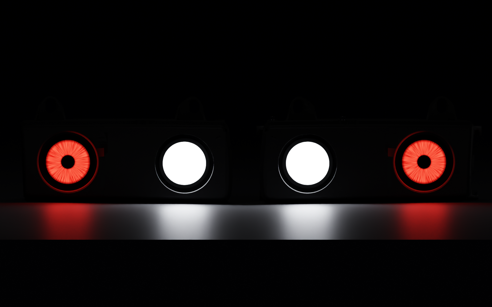
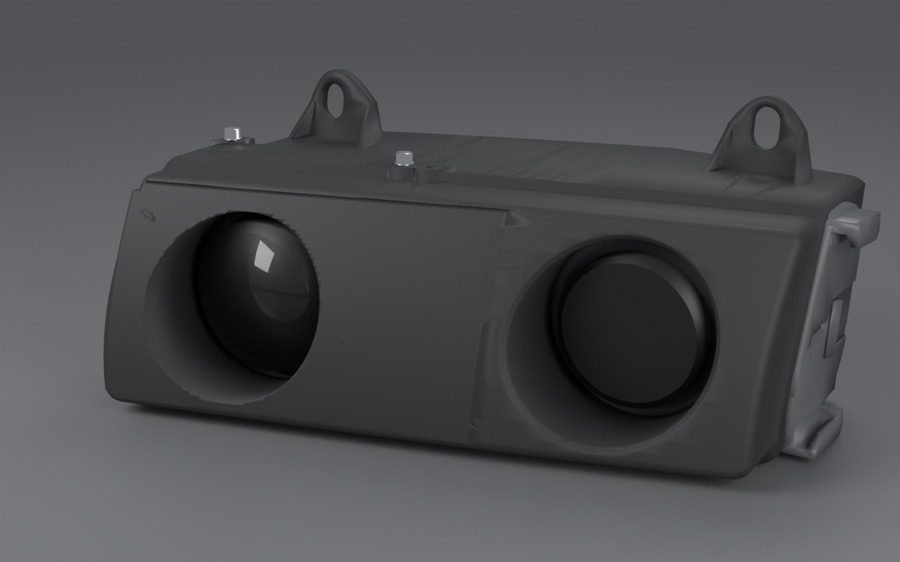
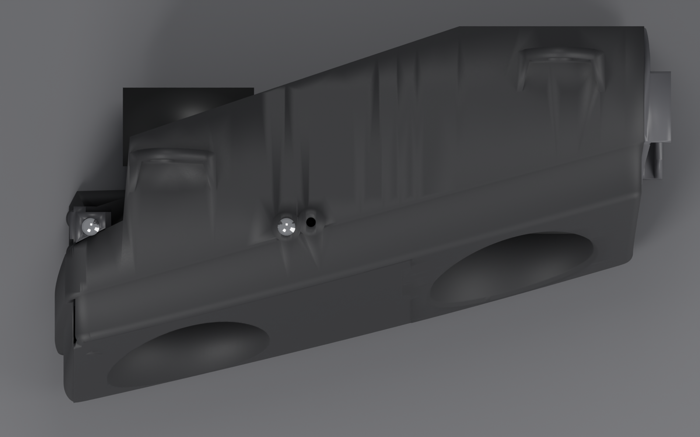
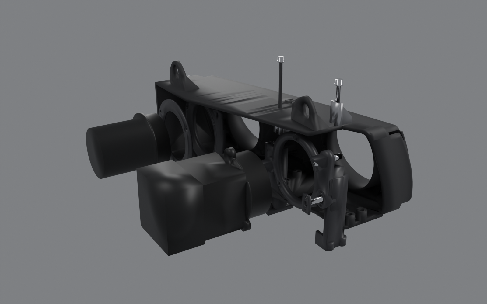
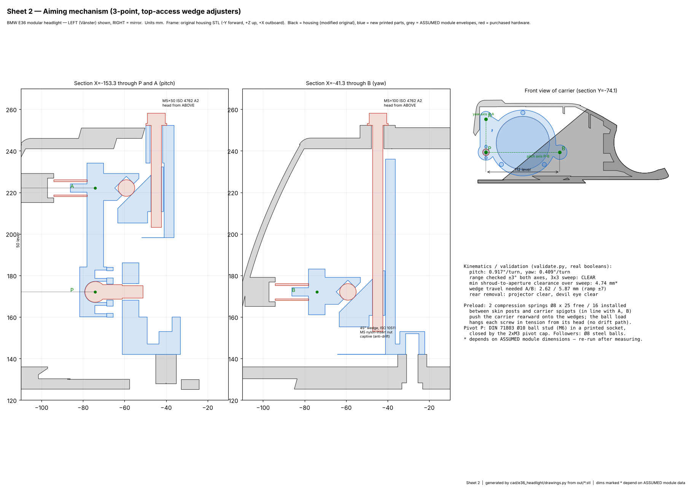

# BMW E36 modular headlight — engineering report (iteration 1)

Left (Vänster) assembly is documented; the right side is generated as an exact mirror.
Frame used throughout = the original housing STL frame: **−Y forward, +Z up, +X outboard (fender / turn-signal side)**.
Tags: **[CAD]** measured from the supplied files · **[DESIGN]** decision made here · **[ASSUMED]** placeholder that must be measured on the purchased part.

---

## 1. Inspection of the supplied files (Phase 1)

| File | What it is | Findings |
|---|---|---|
| `Bmw e36 L+L Vänster.stl` / `Höger.stl` | Main housing ("L+L" = light + air intake) | 37 582 triangles, 336.9 × 215.5 × 163.4 mm. **Right = mirror(left) shifted −390 mm in X**, max deviation 4.5 mm on 31 of 18 777 vertices (re-tessellation on the top surface) → design once, mirror. Not watertight as supplied: 3 loose debris bodies (largest a 13.9 × 13.6 × 0.8 mm disc floating inside the scoop) and 10 pinched (non-manifold) edges at Z≈130 near the inboard lower corner. Repaired with manifold3d without moving any vertex. Material volume 1120 cm³ (thick solid scoop walls). |
| `hållare ljus 90 Vänster/Höger.step` | 10 mm ring holding a Ø90 lamp (Ø101.5 seat, Ø105.5 OD, 3 × Ø7 holes) | Belongs to the **outboard** opening. Not in the housing frame: shift (+140.3, +39.0, +0.1) mm puts its holes on the housing's 3 pilot holes (match ≤0.4 mm) and its front face on the flat tube face at Y = −38.0 (zero-overlap fit). |
| `E36 Blinkersfäste Vänster/Höger.step` | Bracket for the **factory turn signal**, bolts to the outboard end wall (2 × Ø4.1 along X) | In the housing frame. **Kept unchanged**, no part of the new design touches it. |
| `bmw e36 3.5 anslutning.step` | 3.5" intake hose adapter (Ø91 bore, 2 × M4.5 on 130 mm) | Bolts to the rear of the old scoop throat. **Obsolete** in the new design (the scoop is replaced). |

Measured geometry of the housing (left) **[CAD]**:

- **Front face is one smooth surface.** A quadratic fit `Y = f(X, Z)` matches 79 % of the visible face to **0.29 mm RMS** (the rest is rim fillets and the opening lips). That is what makes a truly seamless restored fascia possible.
- Openings: outboard Ø93.0 at (X 87.3, Z 186.1), with a short tube ending in a flat seat face at Y = −38.0 and three Ø5.3 pilot holes (11 deep) on a ~Ø116 pattern. Inboard: a rectangular intake scoop (~140 × 90 mm mouth) narrowing to a round Ø~85–91 throat at Y ≈ 0.
- Plates: bottom Z 125.3–130.3, top 246.3–251.3. The top plate has a 5 mm step whose edge runs **diagonally**, parallel to the face sweep (`Y = −49.5 + 0.275 (X + 40)`). The plate's rear edge is also diagonal, ending at Y ≈ −51 at the inboard end.
- Vehicle interfaces (not modified): 2 top tabs with slotted holes (X ≈ −110 and +115), 1 low tab at the inboard end, turn-signal-bracket interface at X 155–163.
- Clear height inside at the inboard position: **111 mm** (Z 130.3 → 241.3 front).
- The face is swept and laid back: across a Ø93 opening the face depth varies by **37 mm (inboard)** and **41 mm (outboard)**.
- Wall thickness of the original: median 5.0 mm, 1st percentile 2.7 mm.

## 2. Modification strategy (what was done)

1. **Keep the original housing as the body.** All booleans happen on the repaired original mesh. Outer silhouette, mounting tabs, rear plates and the turn-signal-bracket interface are untouched (bounding box unchanged within 0.15 mm).
2. **Remove only the inboard scoop** (box cut inside the bezel, between the plates, X −163…25, Z 136…241).
3. **Restore the original front surface** across the scoop as a 3 mm skin that *is* the fitted surface. The ±0.4 mm residual of the old face inside the rim is shaved off so new and old read as one surface: median deviation of the finished face from the surface = **0.00 mm**, no coincident faces, valid manifold. The result is **one printed body with no front seam**.
4. **Inboard Bi-LED opening** Ø93 (same visual diameter as the outboard one), placed at X −97.3 so both openings sit symmetric inside the bezel (184.6 mm c/c, same Z). A cylindrical return collar mirrors the outboard tube. Three ribs stiffen the new skin.
5. **Outboard Devil Eye** reuses the proven interface: the **original light ring STEP** is moved onto its real seat, its Ø90 bore filled, re-bored for the module and thickened rearward. A clamp ring retains the module flange (0.2 mm preload).
6. **Aiming** (Section 4) lives entirely behind the face. Two bench-installed brackets are screwed **from outside through the floor / top plate** into heat-set inserts, so no fastener shows from the front.

## 3. Optical packaging (Phase 2)

| | Bi-LED projector (inboard) | Devil Eye (outboard) |
|---|---|---|
| Position | X −97.3, Z 186.1 (toward grille) ✔ | X 87.3, Z 186.1 (toward fender / turn signal) ✔ |
| Opening | Ø93, new | Ø93, original |
| Lens front | Y −98.1, i.e. 1 mm behind the most rearward point of the opening rim ("slightly recessed", never protruding) | Y −48.7, same rule |
| Mount | 3 × M5 into the aiming carrier **[ASSUMED pattern]** | flange clamped between the adapter and the clamp ring |
| Aiming | ±3° pitch and yaw, top access | none: decorative, fixed |
| Rear removal | **clear**, pull straight back after 3 screws (checked) | **clear**, after 3 × M4 (checked) |

**The supplier photos give no length.** In the Bi-LED photo, "124 mm" is drawn **vertically** beside the front view, so it is an overall *height*. "80 mm" spans the top of the front view (likely the flange or shroud width), "42 mm" is the lower width, and the two "70 mm" values are drawn on a perspective view. If the module really is 124 mm tall, it **does not fit**: the clear height is 111 mm, and only about 101 mm remains with ±3° travel and 2 mm gaps. All module envelopes are therefore parametric placeholders in `params.py` and must be measured.

Placeholder used for every check: shroud Ø80 × 28, body 70 × 70 × 60, heatsink + fan 75 × 75 × 45 (total 133 long); Devil Eye lens Ø76 sitting 20 ahead of a Ø84 × 4 flange, body Ø70 × 70.

Optical caveat: because of the swept face, the inboard-lower part of each opening rim sits up to 37 mm in front of the lens. Beam spill beyond about 17° toward inboard/down will hit the collar. This is inherent to the E36 face, and the original 90 mm lamp had the same geometry. **Check the cutoff and foreground on a wall before driving.** A flared aperture is the fallback, at the cost of a non-matching opening shape.

## 4. Aiming mechanism (top access)

Three-point tilt carrier (OEM principle), decoupled to first order:

- **P** fixed pivot: DIN 71803 Ø10 ball stud (M6) in a printed socket closed by a 2 × M3 cap. Inboard-low, X −153.3 / Z 172.1.
- **A** vertical aim, directly above P (Z 222.1). Pitch turns about line P–B, which is horizontal. Lever 50 mm → **0.92° per turn** (M5 × 0.8).
- **B** horizontal aim, level with P (X −41.3). Yaw turns about line P–A, which is vertical. Lever 112 mm → **0.41° per turn**.
- Each of A and B is a **45° wedge** sliding vertically in a printed channel, driven by an **M5 screw whose head sits on top** (M5 × 50 at A, M5 × 100 at B). The thread is a **captive ISO 10511 nylon-insert nut** in the wedge: prevailing torque gives drift resistance, as in OEM plastic adjusters.
- The follower is a Ø8 steel ball on a 45° holder. Two Ø8 compression springs between the skin and the carrier push the carrier rearward onto the wedges. The ball load pushes each wedge down/back, so **each screw always hangs in tension from its head** and there is no free play to drift through.
- A's screw falls just behind the original top plate's diagonal rear edge, so its head sits on a tower of the inboard bracket, flush with the top. B's head sits on a flat Ø17 pad on the top plate. Both seats were verified by ray sampling.

Validation (`validate.py`, manifold booleans on the real meshes):

| Check | Result |
|---|---|
| Static interference between all 11 parts + housing | none (only the intended 0.2 mm Devil Eye clamp preload) |
| Aim sweep, pitch × yaw ∈ {−3, 0, +3}°, wedges moved to match | **all clear** |
| Shroud vs opening, worst case over a 7 × 7 sweep | 4.74 mm min clearance |
| Wedge travel needed A / B | 2.62 / 5.87 mm (ramp ±7 mm) |
| Tool path straight down onto each screw head | clear (housing) |
| Washer seat under each head | A: 21/24 samples on the bracket tower, 3 on the plate; B: 24/24 on the pad |
| Module removal straight back | Bi-LED clear, Devil Eye clear |

**Reuse of original E36 adjusters: not done.** I had no dimensions or kinematic data for the factory screws and ball sockets, and assuming compatibility would be inventing it. The interface is a plain M5 screw and seat, so a factory part can be tried later if its thread and length are measured.

## 5. Material, structure, thermal, environment

- **ASA-CF** (Bambu ASA-CF TDS): HDT 102 °C @ 1.8 MPa / 110 °C @ 0.45 MPa, Vicat 108 °C (plain Bambu ASA: 92 / 100 °C). CF raises stiffness but lowers elongation and impact toughness, and Z-direction layer strength is the weak axis. Hence: no thread is cut in plastic (heat-set inserts everywhere), bosses are ≥ Ø12, the carrier is loaded in-plane, and the brackets are bolted at both ends where possible.
- **Thermal:** the projector touches printed plastic only at its mounting face (carrier). The heatsink and fan sit in free air behind (the housing is open at the rear). Nothing is validated: **measure the mounting-face temperature after 30 min on at 35 °C ambient, engine bay closed**. If it is above about 70 °C, cut the carrier from 3 mm aluminium (same outline, the STEP is provided) or add a PEEK/G10 spacer. Engine-bay heat soak near the radiator support is unknown.
- **Water / sealing:** the design is a **bezel and carrier, not a sealed lamp**. The openings have no cover lens and the rear is open (as in the original intake design), so sealing must come from the modules themselves (supplier IP claims unverified). Three Ø6 drains are in the floor. **Not claimed waterproof or road-legal.**
- **Red forward light:** the red Devil Eye is for show use. A forward-facing red light is generally not road legal. The Bi-LED needs E-mark / local approval and correct traffic-side cutoff.
- **Thickness of the modified housing:** median 5.0 mm, 5th percentile 2.5 mm; 0.9 % of the surface is below 1.2 mm. These are feather edges where planar cuts cross the old sloped scoop walls (floor near Z 130–136, under the top plate, and a few flaps at the inboard top corner behind the skin), all hidden and non-structural. They can be cleaned in Fusion if wanted.

## 6. Printing (Phase 6) — real slicer results

**Bambu Lab H2D build volume (Bambu spec): 325 × 320 × 325 mm for single-nozzle printing.** The 350 mm figure is only the combined reach of both nozzles. The housing is 336.9 mm long, so **it does not fit square**. An orientation search on the real mesh found that the natural orientation (bottom plate on the bed) **fits when rotated 16° about Z**: footprint 317.5 × 297.1 mm. No split, no tilt, no seam.

Slicer: **PrusaSlicer 2.7.2 CLI** with an *approximate* H2D + ASA-CF profile (`config/h2d_asacf_0.20.ini`: 0.4 mm hardened nozzle, 0.20 mm layers, 4 walls, 15 % gyroid, organic supports, 270/100 °C). These are real slicer outputs for this profile, **not Bambu Studio numbers**. Re-slice in Bambu Studio with the official profiles for production; expect time to differ by roughly ±30 %.

| Part (left) | Orientation | g | cm³ | support g | time |
|---|---|---|---|---|---|
| housing (modified) | bottom on bed, 16° about Z | 638.3 | 569.9 | 140.6 | 28 h 09 m |
| projector_carrier | +Y up | 33.9 | 30.2 | 7.0 | 1 h 49 m |
| pivot_cap | −Y up | 0.8 | 0.8 | 0 | 3 m |
| wedge_A / wedge_B | +X up | 4.1 each | 3.6 each | 0.4 each | 12 m each |
| inboard_bracket | +X up | 27.1 | 24.2 | 2.8 | 1 h 12 m |
| outboard_pillar | +X up | 26.9 | 24.0 | 3.0 | 1 h 08 m |
| devil_adapter | +Y up | 33.3 | 29.7 | 1.5 | 1 h 18 m |
| devil_clamp | −Y up | 12.1 | 10.8 | 0 | 25 m |
| **per headlight** | | **781** | **697** | **156** | **34.5 h** |
| **pair** | | **1.56 kg** | | | **≈69 h** |

Filament cost at an **assumed** 40 per kg: about 31 per headlight, 62 per pair (set your local price in the ini). Organic supports cut the housing's support material from 446 g (snug) to 141 g, mostly inside the cavity under the top plate. Dry ASA-CF before printing, use an enclosure at temperature and a hardened nozzle, and print the housing with a draft shield or closed chamber to limit warping on its 320 mm length.

## 7. Missing critical dimensions (blocking a production release)

1. **Bi-LED module**: overall height (the 124 mm in the photo is a height), length, shroud OD and length, mounting pattern/thread, heatsink/fan envelope, connector position, mass and CG. Ideally the manufacturer's drawing or a 3D scan.
2. **Devil Eye module**: lens OD, flange OD/thickness/holes, body length, controller box size, cable exit, whether "1 in 1" has a functional beam, and whether red is actually one of its 33 modes (the photo shows green).
3. **Vehicle**: clearance above the top plate for a hex key with the hood open (both screw heads at Y ≈ −45), and space behind the housing (radiator support, airbox, washer bottle, horn) for the projector heatsink and fan, which reach Y ≈ +35.
4. DIN 71803 stud seat height (ball centre to collar, assumed 13 mm, shim to suit) and the inserts actually bought (hole sizes in `params.py`).
5. Original fasteners used for the light ring (Ø5.3 pilots, Ø7 clearance; M6 thread-forming assumed).
6. Measured temperature at the projector mounting face.

## 8. Main risks

| Risk | Severity | Mitigation |
|---|---|---|
| Real projector taller than 101 mm or with a different flange | High | measure, update `params.py`, rerun `make all`; checks are automatic |
| Top access to the screws blocked by a body panel | High | verify on the car before printing; screw axes are parameters |
| Beam clipped by the swept opening rim | Medium | wall test; optional flared aperture |
| Heat at the carrier | Medium | thermocouple test; aluminium carrier fallback |
| Water ingress / condensation in modules | Medium | modules' own sealing, drains, show use |
| Housing warp over 320 mm, CF brittleness at bosses | Medium | enclosure, dried filament, inserts, no self-tapping into CF |
| 34 h single print failure | Medium | first article in cheap ASA/PETG for fit check |
| Thin feather edges from the cuts | Low | hidden; optional cleanup |

## 9. Recommended development sequence from here

1. Buy both modules, measure them, enter the data in `params.py`, rerun `build → validate`.
2. Check the vehicle: hex-key access from above, rear depth.
3. Print a **fit-check housing in cheap ASA or PETG** (or just the front half plus tabs) and test it on the car.
4. Print the carrier and brackets, assemble, check aim range, set the spring preload, and run the thermal test.
5. Wall-aim the beam and check the cutoff (inboard lamp).
6. Final ASA-CF print, sliced in Bambu Studio.

## 10. Deliverables (left and right)

| Path (after `make all`, in `out/`) | Content |
|---|---|
| `housing_{L,R}_mod.stl` | modified housing, printable (mesh-derived; Fusion: insert mesh, convert to B-rep if features are needed) |
| `parts/*_{L,R}.step / .stl` | carrier, pivot cap, wedges A/B, inboard bracket, outboard pillar, Devil Eye adapter and clamp, ASSUMED module placeholders, hardware visuals |
| `step/assembly_new_parts_{L,R}.step` | all new solids in installed position |
| `gcode/*.gcode`, `slicing.json` | PrusaSlicer output, approximate H2D profile |
| `validation.json`, `thickness.json` | engineering checks |
| `renders/01…08*.png`, `drawings/*.pdf` | the 8 required views; 3 dimensioned A3 sheets |

A faceted STEP of the housing was produced and rejected: 110 MB and fails B-rep checks. The STL is the honest form of a mesh-born body.

